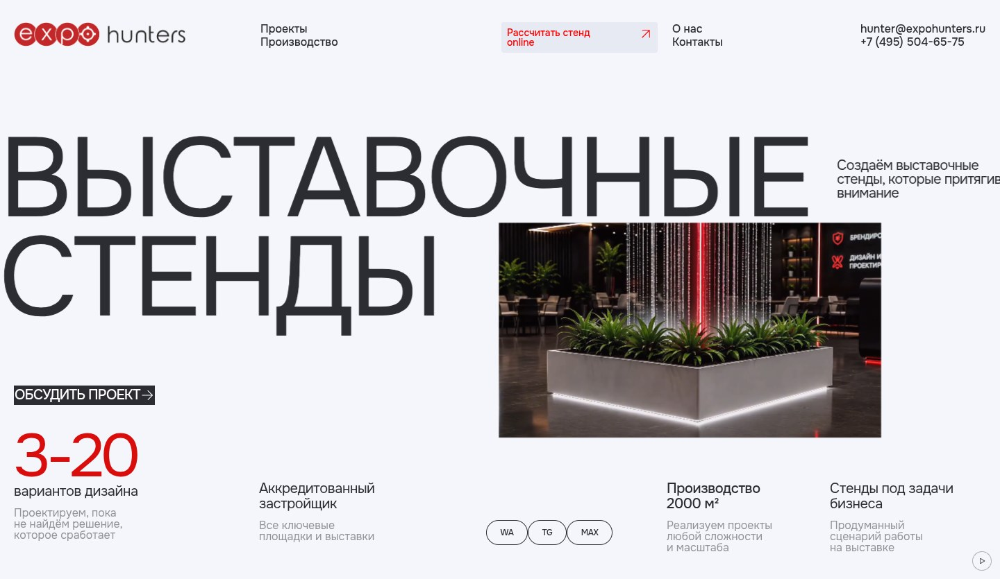

# Expo Hunters

Два экрана сайта по макету из «Для кодекса.fig», предоставленным кадрам и видео. Название репозитория `balance-website` сохранено. React + TypeScript + Vite; все ресурсы локальные, серверная часть не требуется.

**[Открыть работающий сайт](https://kruglovadarias-cpu.github.io/balance-website/)** — появление элементов, следование за курсором, жидкая деформация и переход при прокрутке доступны прямо в браузере.



## Посмотреть анимацию без установки

[Скачать интерактивную версию](docs/expo-hunters-preview.zip?raw=true). Распакуйте ZIP и откройте `index.html` в браузере Chrome на компьютере. Дождитесь появления элементов, двигайте мышью и прокрутите страницу вниз и обратно. Круглая кнопка справа снизу ставит движение на паузу.

Отдельный [index.html](docs/index.html) можно скачать со страницы файла в GitHub кнопкой **Download raw file** (стрелка вниз). В нём уже встроены видео и все ресурсы. Команда `npm run preview:offline` обновляет и этот HTML, и ZIP.

В архиве настоящие компоненты сайта и WebGL-эффект; видео, логотипы и шрифт встроены в HTML. Интернет и сервер не требуются. На телефоне нет следования за мышью; при системном уменьшении движения доступны обычные элементы управления видео. При недоступном WebGL ролик играет без деформации. Файл показывает версию на момент сборки и не обновляется автоматически.

Для разработчика: `npm run preview:offline` пересобирает `docs/expo-hunters-preview.zip` из актуальных исходников; нужны Node.js 24 и Python 3. `npm run test:offline` проверяет HTML при отключённой сети. Если политика управляемого Chromium запрещает `file:`, тест отмечает ограничение и проверяет те же байты HTML через `setContent` в изолированной вкладке; прямое открытие файла в таком прогоне не подтверждается. После правок архив нужно обновлять вместе с кодом. Обычная сборка сайта не меняется.

## Запуск

Нужен Node.js 24 и npm. Используйте существующий checkout: создавать отдельный Git worktree не требуется.

```sh
npm ci
npm run dev
```

`npm run build` проверяет TypeScript и собирает сайт в `dist/`. `npm run preview` запускает собранную версию.

## Что уже работает

- Тёмное вступление с логотипом, затем последовательное появление шапки, заголовка, кнопки и преимуществ.
- Непрерывная горизонтальная строка: заголовок, пояснение и точка.
- За мышью следует реальное видео первого экрана expohunters.com. Liquid Distortion повторяет деформацию фотографии из присланного `index.html`: интенсивность примера 86, смещение уменьшено ровно вдвое до 43. Деформируются и содержимое, и контур, в исходном соотношении 2:1. Поле жидкости строится с исходной интенсивностью, чтобы коэффициент 0.5 не применялся повторно. Происхождение параметров — в `design/liquid-reference.json`.
- Размытие, CSS-маски с градиентами и растушёвка удалены. Контур имеет только сглаживание в один пиксель буфера, которое не расширяется при увеличении видео.
- Плашка останавливается за 24 px до хедера и локально перед кнопкой «Обсудить проект». Над мессенджерами движение свободное; к ограничению у кнопки рамка подходит постепенно.
- При прокрутке тот же HTMLVideoElement сразу начинает плавно увеличиваться во второй экран. Все координаты и размеры используют общий прогресс с коротким сглаживанием; позднего переключения между отдельными фазами нет. Ролик продолжает играть и при обратной прокрутке.
- На компьютере один canvas отображает видео на всём пути прокрутки, без переключения слоёв. Буфер меняет размер и перерисовывается в одном кадре; поле жидкости сохраняется. Увеличение плавно ослабляет деформацию видео. На втором экране расчёт жидкости останавливается, а отображение видео продолжается. На сенсорных экранах используется нативное видео; свайп страницы не блокируется.
- Пауза движения останавливает также видео. Поддерживаются `prefers-reduced-motion`, нативное видео без WebGL и управление диалогами с клавиатуры.
- Кнопки открывают контакты или бриф. Бриф открывает почтовую программу, а не отправляет данные на сервер. Письмо пользователь отправляет самостоятельно.

## Как вносить правки

| Что меняем | Где |
| --- | --- |
| Пауза вступления, скорость строки, инерция курсора, сила эффекта и сглаживание скролла | `src/config.ts`, объект `motion` |
| Почта, телефон, ролик и ссылки на мессенджеры | `src/config.ts`, объект `site` |
| Границы движения плашки и переход между экранами | `src/HeroMedia.tsx` |
| Тексты и порядок блоков | `src/App.tsx` |
| Размеры, отступы, адаптация | `src/styles.css` |
| Цвета | `src/tokens.css` |
| Жидкий эффект и его шейдеры | `src/LiquidHover.tsx`, `src/liquidShaders.ts` |
| Логотип | `src/Logo.tsx` |
| Исходные параметры слоёв и происхождение ресурсов Figma | `design/figma-source.json` |

Для следующей правки достаточно написать, например: «картинка слишком отстаёт», «заголовок медленнее», «блок 3–20 появляется раньше». Код эффекта отделён от оформления.

## Оригиналы из Figma

Локальный файл «Для кодекса.fig» прочитан: 515 слоёв, девять кадров сценария на странице `expohunters`. Тёмный и светлый логотипы 4034×576 и их превью 505×72 используются без изменения байтов. Фотография стенда и её превью удалены из сайта и `public/`: вместо них используется реальное видео первого экрана https://expohunters.com/.

Локальный ролик `public/videos/expo-hunters-hero.mp4` получен из `/videos/glavnoe-szhatoe.mp4`: исходный H.264-поток 1280×720, 60 fps, около 19 секунд, скопирован без перекодирования. Неиспользуемая звуковая дорожка удалена, MP4 подготовлен для быстрого начала воспроизведения. Источник и контрольные суммы — в `design/media-source.json`. Видео на сайте загружается со своего домена.

Типографика — Onest: локально хранится официальный вариативный шрифт Google Fonts с лицензией SIL OFL. Файл Figma содержит название и параметры шрифта; сам файл шрифта получен из официального источника. Цвета, размеры, координаты блоков, межбуквенные интервалы и начертания сверены по слоям. Исходные данные и SHA-256 ресурсов записаны в `design/figma-source.json`.

При первоначальной сверке онлайн-доступ к Figma был недоступен; загрузка сайта от Figma не зависит. Чтение `.fig` не означает, что изменения автоматически записываются обратно в облачный макет. Для следующих сверок можно передавать обновлённый локальный файл размером до 32 МиБ. Подробности импорта — в [design/README.md](design/README.md).

## Что ещё уточнить

URL для WA, TG и MAX пока не предоставлены: кнопки видны, но отключены. Контакты взяты с кадров. Вступление повторяется при каждой полной загрузке страницы; переход между экранами обратимый. Эти исходные решения можно изменить.

## Проверки

```sh
npx playwright install --with-deps chrome
npm test
```

Если Chromium с поддержкой H.264 уже установлен: `PLAYWRIGHT_CHROMIUM_EXECUTABLE_PATH=/usr/bin/chromium npm test`. В CI используется Chrome для проверки реального MP4.

Проверяются загрузка оригиналов и кириллического шрифта, вступление, движение за указателем, фактическая деформация содержимого видео, чёткие края без растушёвки, отсутствие прозрачных кадров после изменения размеров до paint, переход в обе стороны при прокрутке, диалоги и почтовые ссылки, пауза, сенсорный экран, уменьшенное движение и отсутствие WebGL. GitHub Actions выполняет сборку и браузерные проверки при push/PR.

## Просмотр через GitHub Pages

Сайт опубликован: https://kruglovadarias-cpu.github.io/balance-website/. Настройки Pages: **Deploy from a branch → gh-pages → / (root)**. Репозиторий публичный; размещение использует бесплатный GitHub Pages. Первую публикацию владелец включил через интерфейс GitHub, поскольку подключённая интеграция не имеет прав менять настройки Pages.

После правок и проверки выполните `npm run deploy:pages`. Команда собирает приложение, получает актуальную ветку `gh-pages` во временную папку и отправляет туда новую сборку без force-push. Исходный checkout и рабочая ветка не переключаются. Файл `CNAME`, если он будет добавлен, сохраняется. Если сборка не изменилась, команда не создаёт коммит. Изменять файлы сайта нужно в `src/`, а `gh-pages` содержит готовую сборку.

Публикация запускается отдельно от сохранения исходников. После отправки сборки дождитесь статуса `built` в GitHub Pages и проверьте публичный адрес. В облачной среде используется штатная HTTPS Git-аутентификация; токены в файлы не записываются. Дополнительные секреты для сайта не нужны.

Пути ресурсов относительные: сборка поддерживает размещение в подпапке репозитория. Старый workflow `Publish website (manual)` предназначен для отдельного режима **Source: GitHub Actions**; текущая публикация его не использует, менять источник Pages для обычных правок не требуется.
